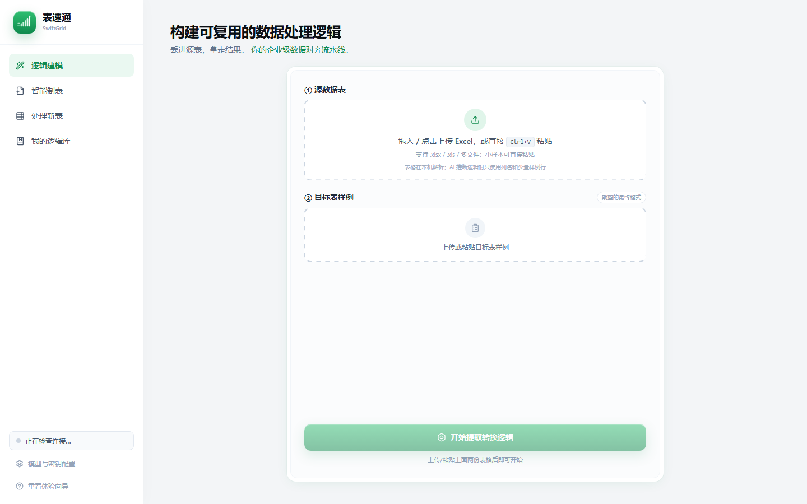
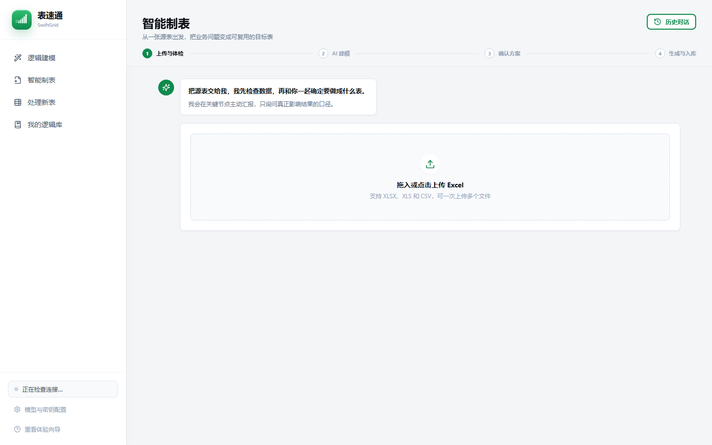
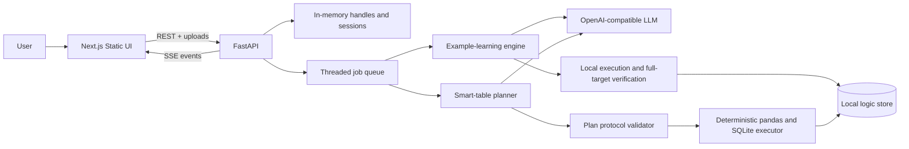
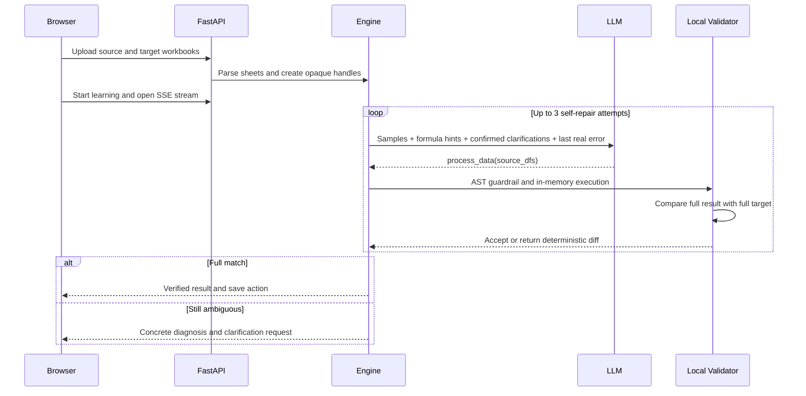

<div align="center">


# SwiftGrid: Learn Spreadsheet Workflows from Examples

**Teach with a source workbook and a finished example. Reuse the verified logic on the next workbook.**

[](https://www.python.org/)
[](https://nextjs.org/)
[](https://fastapi.tiangolo.com/)
[](LICENSE)
[](README_zh.md)

</div>

SwiftGrid (表速通) is an AI-assisted spreadsheet workflow tool for operations, finance, sales, and HR teams. Instead of asking users to translate a finished Excel workflow into a long prompt, SwiftGrid learns from the artifact they already have: the source workbook and the expected result.

The LLM proposes a reusable transformation. The local engine executes it against the complete source and accepts it only when the complete output matches the target. A second workflow starts with source data only: the model proposes a constrained table plan, while deterministic code calculates every final value.

> **Status:** open-source research and portfolio release. The local single-user workflow is runnable; it is not yet a hardened anonymous multi-tenant SaaS.

## Product Preview

| Learn reusable logic | Build a new table from source data |
| --- | --- |
|  |  |

Live demo: **deployment pending**. The repository includes a production Dockerfile so the same frontend and backend can be deployed as one service when the hosting and access policy are confirmed.

## 🌟 Core Features

| Feature | What it does |
| --- | --- |
| 🎯 **Example-driven learning** | Uses a source workbook plus a finished target example; users do not need to write pandas code or a complete specification. |
| 🔁 **Generate → execute → verify loop** | Runs model-authored logic locally against the full dataset and returns deterministic differences to the next repair attempt. |
| 💬 **Evidence-based clarification** | When the rule cannot be uniquely inferred, surfaces the concrete row/column mismatch and drafts a plain-language question. |
| 🧩 **Multi-sheet workflows** | Parses every source sheet and can return one DataFrame or a named set of output sheets. |
| 🧠 **Constrained smart-table planning** | With source data only, the model emits a typed JSON plan instead of final numbers or arbitrary SQL. |
| 🧮 **Deterministic full-data execution** | Filters, expressions, grouping, aggregation, sorting, and result generation run locally with pandas/SQLite. |
| 📚 **Reusable logic library** | Stores verified Python logic or smart-table plans and matches future workbooks by structural profile. |
| 📡 **Streaming progress** | Long-running model and data jobs publish progress, clarification, success, error, and cancellation events over SSE. |
| 🔌 **OpenAI-compatible models** | Defaults to DeepSeek and supports compatible private gateways through model/base URL configuration. |

## 🏗️ Architecture



The running product has two distinct LLM contracts:

1. **Learn from an example:** the model writes `process_data(source_dfs)`; local execution and full-target comparison decide whether it is accepted.
2. **Compose from source data:** the model writes a constrained plan; a validator rejects unknown fields and unsupported operations before deterministic execution.

### The example-learning loop



The model never certifies its own output. For a detailed component map, data boundary, smart-table protocol, and the experimental multi-agent IR, read [Backend & LLM Architecture](docs/ARCHITECTURE_zh.md).

## 🧠 What Is New Compared with a Generic Spreadsheet Chatbot?

- **A finished workbook is treated as executable evidence.** The target is not just attached context; it is the local acceptance test.
- **The model is separated from final calculation.** It proposes code or a plan, while the runtime computes the complete result.
- **Repair is grounded in actual failures.** Syntax errors, execution errors, and value mismatches are fed back as bounded evidence.
- **Reusable assets survive the chat.** Verified transformations are stored, structurally matched, and applied to later periods.
- **Ambiguity remains visible.** Unsupported or under-specified rules become explicit questions instead of silent model assumptions.

## Repository Map

```text
frontend/                         Next.js 16 static frontend
swiftgrid/backend/
  api/                            FastAPI REST and SSE routes
  services/orchestrator.py        Background jobs and event streaming
  services/compose_ai.py          LLM-to-constrained-plan adapter
  services/compose_plan.py        Plan protocol validation
  services/compose.py             Import, profiling, SQLite execution, export
engine.py                         Example learning, verification, repair, reuse
storage.py                        Local logic metadata and artifacts
scripts/modeling_multi_agent/     Experimental typed IR/compiler/auditor
docs/ARCHITECTURE_zh.md           Detailed backend and LLM architecture
docs/DEPLOYMENT_zh.md             Hosting choices and production checklist
Dockerfile                        Single-service frontend + backend image
```

`app.py` is the earlier Streamlit prototype. The recommended product path is `frontend/` + `swiftgrid/backend/`.

## Get Started

### Prerequisites

- Python 3.11+
- Node.js 20+
- A DeepSeek key or another OpenAI-compatible endpoint for real LLM flows

### 1. Start the backend

```bash
python -m venv .venv

# Windows
.venv\Scripts\pip.exe install -r requirements.txt
.venv\Scripts\python.exe -m uvicorn swiftgrid.backend.main:app --host 127.0.0.1 --port 8000 --reload

# macOS / Linux
.venv/bin/pip install -r requirements.txt
.venv/bin/python -m uvicorn swiftgrid.backend.main:app --host 127.0.0.1 --port 8000 --reload
```

### 2. Start the frontend in development

```bash
cd frontend
npm ci
npm run dev
```

Open `http://localhost:3000`. Set `NEXT_PUBLIC_API_BASE=http://localhost:8000` in `frontend/.env.local` for split frontend/backend development.

### 3. Build the same-origin release

```bash
cd frontend
npm ci
npm run build
cd ..
python -m uvicorn swiftgrid.backend.main:app --host 127.0.0.1 --port 8000
```

The FastAPI app detects `frontend/out` and serves the static frontend at `http://localhost:8000`.

### Docker

```bash
docker build -t swiftgrid .
docker run --rm -p 8000:8000 \
  -e SWIFTGRID_API_KEY=your-key \
  -e SWIFTGRID_MODEL=deepseek-v4-pro \
  -e SWIFTGRID_BASE_URL=https://api.deepseek.com \
  -e SWIFTGRID_ALLOW_RUNTIME_CONFIG=false \
  -v swiftgrid-data:/app/data \
  swiftgrid
```

Do not put a real key in source control. Copy `.env.example` for local configuration or use your hosting provider's secret manager.

## Model Configuration

| Variable | Default | Purpose |
| --- | --- | --- |
| `SWIFTGRID_API_KEY` | empty | Server-side OpenAI-compatible API key |
| `SWIFTGRID_BASE_URL` | DeepSeek API | Compatible model endpoint |
| `SWIFTGRID_MODEL` | `deepseek-v4-pro` | Model identifier |
| `SWIFTGRID_ALLOW_RUNTIME_CONFIG` | `true` | Allow the browser to replace the process-wide model settings; set `false` on shared deployments |
| `PORT` | `8000` | Container/cloud HTTP port |

## Verification

```bash
cd frontend
npm run typecheck
npm run build

cd ..
python -m py_compile engine.py storage.py swiftgrid/backend/main.py
python -m unittest discover -s tests -p "test_modeling_multi_agent_*.py" -v
python -m unittest tests/test_engine_guardrail.py -v
```

Tests that call a live model consume API credits and are intentionally separate from offline checks. Hosting choices and the production checklist are documented in [Deployment Options](docs/DEPLOYMENT_zh.md).

## Strengths and Trade-offs

### Strengths

- Full-target verification creates a stronger acceptance condition than prompt-only generation.
- Smart-table results are calculated locally from a validated protocol.
- SSE makes long model/data jobs observable and cancellable at workflow boundaries.
- The same runtime supports multi-sheet inputs, reusable logic, Excel export, and model-compatible private endpoints.

### Current limitations

- The active runtime is single-instance and single-tenant; sessions, model configuration, and the logic library are shared.
- Complex workbook regions, macros, and pivot-table fidelity are not universally supported.
- Example learning still executes generated Python. AST validation reduces accidental abuse but is not a hardened hostile-code sandbox.
- The experimental multi-agent IR/compiler is included for research and testing but is not fully wired into the main API.
- Public hosting still needs authentication, per-user isolation, rate limits, quotas, and a stronger execution sandbox.

## Roadmap

1. Move generated-code execution into an isolated worker with CPU, memory, filesystem, and network limits.
2. Replace process-global sessions/configuration with user-scoped storage and authentication.
3. Integrate the typed Workbook Intent IR into the production smart-table pipeline.
4. Add workbook region/block modeling for complex report templates.
5. Establish development and holdout benchmarks with zero silent-wrong-success as a release gate.

## Security

Do not expose the current repository as an anonymous public SaaS without additional controls. Uploaded workbooks may contain sensitive business data, and a server-owned model key can generate unbounded cost if the API is left open. See the deployment and data-boundary notes in [the architecture document](docs/ARCHITECTURE_zh.md).

## License

SwiftGrid is released under the [MIT License](LICENSE).

This project is developed for product exploration, engineering research, and portfolio demonstration. The README structure and architecture storytelling were inspired by the clarity of [QueryMind](https://github.com/Tangxihong0922/QueryMind); SwiftGrid's implementation, diagrams, copy, and visual assets are original.
