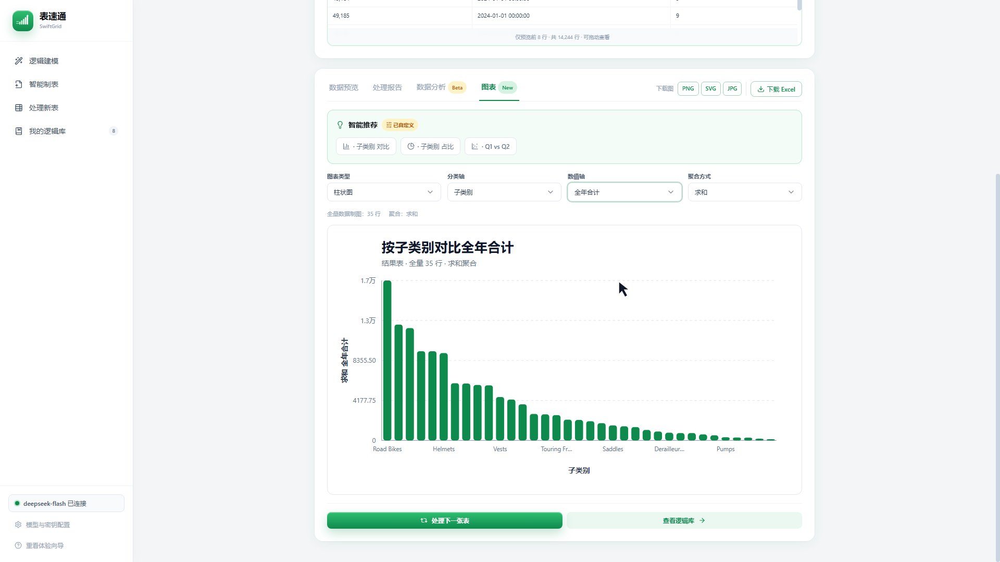
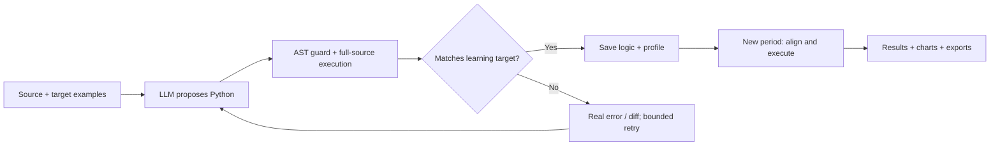

# SwiftGrid: Learn a Spreadsheet Workflow, Reuse It Next Period

**Provide source workbooks and a finished report. Learn the transformation, verify it locally, and save it for the next dataset.**

[中文首页](README.md) · [Demo and evidence](docs/DEMO_CASE_zh.md) · [Architecture](docs/ARCHITECTURE_zh.md) · [Example files](examples/quarterly-sales/README.md)

## Demo

A 3:50 recording of the real web application, with Chinese narration and subtitles: four source tables, example-driven learning, a saved logic library, two subsequent periods, result analysis, charts, and downloads.

<!-- DEMO_VIDEO -->

https://github.com/user-attachments/assets/21b556b6-2f33-4b9f-8b28-df14444e9a6f

**Chart view:** recommendations, configurable axes and aggregation, and image export.



The recording uses actual model requests and downloaded results. Learning wait time is shortened and labelled. Smart-table composition remains experimental and is excluded from this showcase.

## The problem and my contribution

The project originated in my product management internship. Campaigns and feature launches required changing monitoring definitions, followed by repeated daily data preparation using the same rules.

I own problem definition, all interaction design, architecture decisions, acceptance checks, and iteration. AI tools assisted backend development, parts of structural matching, testing, and demo preparation. Feedback about confusing workbook names led to input previews; small-data tasks led to a paste-table entry point. [Product decisions and ownership, in Chinese](docs/PRODUCT_STORY_zh.md)

### A paid delivery validated the need

For one banking professional, I used AI-assisted development to build a dedicated deterministic script processing **four quarters, 20 sheets, and approximately 1.146 million sales-data rows**. The task went from approximately half a day of manual work to approximately 10 minutes, and the user voluntarily paid for the delivery.

This is an author-confirmed custom-script delivery, with customer data kept private. It demonstrates task value, not a general million-row capability claim for the current web product. The separately reproducible web case is below.

## Core capabilities

| Capability | Behavior |
| --- | --- |
| Learn from examples | Source workbook plus target example become a candidate Python transformation |
| Execute and verify | Full-source execution and full learning-target comparison determine acceptance |
| Save and reuse | Store code and a structural profile; normal reuse runs saved code without a model call in that execution branch |
| Inspect progress and results | Input previews, SSE progress, result tables, reports, and downloadable scripts |
| Visualize and export | Basic statistics, chart recommendations, configurable axes, Excel and PNG/SVG/JPG downloads |

## How the LLM is used



The model receives fields, limited source/target samples, formula hints, clarifications, and error feedback. Full calculations run locally. The default learning loop allows up to three generation attempts. Reuse first runs saved logic; execution errors may trigger model repair, with a replay against the original learning target before trying new data.

### Data boundaries: what the model sees and what is stored

Full calculations run on the machine or server hosting SwiftGrid. **Fields, sample cells, formula hints, and error summaries can still be sent to the configured model service.** Saving logic also persists learning data for later replay.

| Data or artifact | Current handling | Boundary |
| --- | --- | --- |
| Full source and learning target | Parsed, executed and compared in the service; learning data is persisted when logic is saved | Protect the host and local `data/` directory |
| Fields and limited source/target samples | Sent as learning context | Samples can contain real business cells |
| Formulas, clarifications, errors and differences | Used to understand the task and propose repairs | These can also contain sensitive business information |
| New-period data | Saved code executes locally; errors and the new structure enter repair context if execution fails | The normal execution branch makes no model call; the API still requires model configuration for repair |
| Scripts, profiles and learning data | Stored in the local logic library for execution and replay | The current library has no per-user isolation |
| Model key | Server environment or process configuration, used to call the model service | Keep it out of the repository; shared deployment also needs access and spending controls |

The current design uses local full-data execution with limited model context. Enterprise use still needs appropriate handling of samples, logs, storage, and the chosen model gateway.

### Known limitations

1. **Passing the learning example is a scoped result.** Several rules can fit one example. Changes in categories, joins, or deduplication rules may produce silent business errors on later data. Cross-period tests and business constraints remain necessary.
2. **Matching data does not establish full workbook equivalence.** Complex layouts, macros, pivot tables, formatting and sheet-name contracts are not fully supported. Recorded exports use `结果`; reference files use `Sheet1`.
3. **Execution and service isolation are incomplete.** AST guards are not a strong sandbox. Sessions, configuration and storage are shared within one instance. A shared service needs isolated execution, authentication, tenant separation and resource/spending controls.
4. **The evidence has a defined scope.** Three periods of one case are not an overall accuracy benchmark. Basic statistics are not professional business diagnosis. Smart-table composition and multi-agent modeling remain exploratory; retrieval and enterprise knowledge are planned.

API locations, sequence diagrams and implementation entry points are available in the [architecture document](docs/ARCHITECTURE_zh.md).

## Public, reproducible case

The case uses a prepared version of Microsoft's AdventureWorks sample data: order headers, order details, products, and subcategories. It requires three joins, quarterly aggregation and pivoting, zero-filled missing quarters, totals, ranking, and shares.

| Period | Detail rows | Output rows | Recorded export check |
| --- | ---: | ---: | --- |
| Learning | 20,817 | 18 | Values, columns, and row order match |
| Next year | 56,721 | 35 | Values, columns, and row order match |
| First half only | 37,191 | 30 | Values and ordering match; Q3/Q4 are zero |

Inputs, targets, an independent reference calculation, and recorded outputs are in [examples/quarterly-sales](examples/quarterly-sales/README.md). Verify without an API key:

```bash
python examples/quarterly-sales/verify_results.py
```

The script checks supplied artifacts; it does not measure fresh LLM generation success. Actual exports use a different sheet name from the reference (`结果` versus `Sheet1`), so full workbook equivalence is not claimed. Three periods of one case are not an overall accuracy benchmark.

## Run locally

Use Python 3.11+, Node.js 24+, and an OpenAI-compatible model service. Install Python requirements, run `npm ci` and `npm run build` in `frontend`, configure `SWIFTGRID_API_KEY`, `SWIFTGRID_BASE_URL`, and `SWIFTGRID_MODEL`, then start:

```bash
python -m uvicorn swiftgrid.backend.main:app --host 127.0.0.1 --port 8000
```

Open `http://localhost:8000`. [Complete setup and Docker instructions](docs/GETTING_STARTED_zh.md)

## Status and next steps

This is a local single-user portfolio release, without an always-on public service. Smart-table composition and multi-agent IR remain exploratory. AST guards are not a strong sandbox; authentication, tenant isolation, resource controls, and stronger execution boundaries are needed for a shared public service.

| Priority | Planned work | Proposed acceptance direction |
| --- | --- | --- |
| P0: correctness | Missing values, duplicate keys, new categories, absent quarters and join-cardinality changes | Independent cases, complete-result checks, totals and business invariants |
| P0: export contract | Fields, column order, types, sheet names and supported layouts | Downloaded files meet an explicit contract; unsupported features are identified |
| P0: execution boundary | Isolated workers, resource limits and file/network permissions | Verify resource and permission restrictions and model-visible data |
| P1: controlled composition | Confirm metrics, classifications and business definitions before execution | Ambiguities trigger questions; plans can be inspected, executed and audited |
| P2: enterprise knowledge | Explore LLM Wiki, business ontology, retrieval and richer reporting | Evaluate intent understanding and error reduction before selecting integration approaches |
| Shared-service stage | Authentication, isolation, budgets, persistent storage and operations | Access, resources and costs are controlled before public deployment |

These are proposed priorities, not delivered capabilities or achieved metrics. [Product scope and roadmap](docs/PRODUCT_PLAN_zh.md)

## License and references

Code: [MIT](LICENSE). Example data: [Microsoft AdventureWorks](https://github.com/microsoft/sql-server-samples/tree/master/samples/databases/adventure-works), with [source notes and MIT attribution](examples/quarterly-sales/SOURCE_AND_LICENSE.md).

README organization and workflow presentation were inspired by [QueryMind](https://github.com/Tangxihong0922/QueryMind); the descriptions here reflect SwiftGrid's implementation and evidence.
