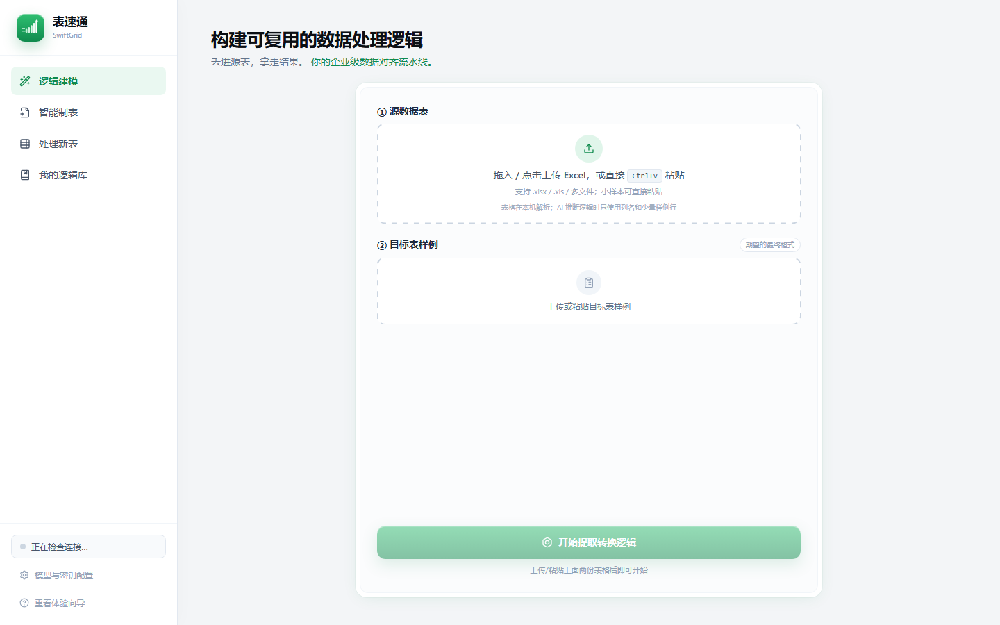
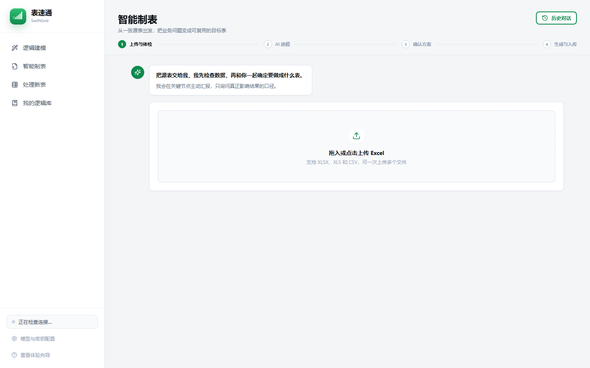
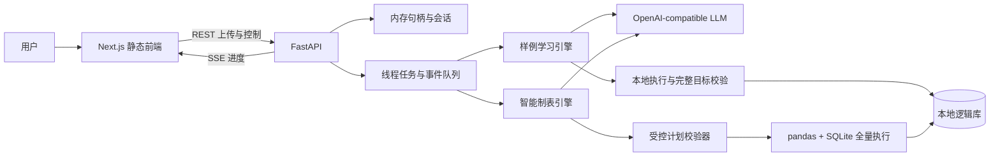
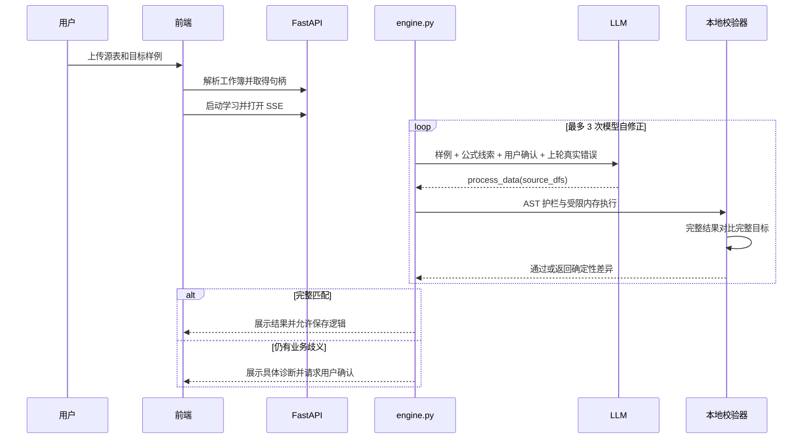

<div align="center">


# SwiftGrid（表速通）

**给一份源表和一份做好的结果表，让 AI 学会这套 Excel 处理逻辑，并在下一期稳定复用。**

[](https://www.python.org/)
[](https://nextjs.org/)
[](https://fastapi.tiangolo.com/)
[](LICENSE)
[](README.md)

</div>

表速通是一款面向运营、财务、销售和人力场景的 AI 表格工作流工具。它不要求用户先把复杂 Excel 规则翻译成长篇提示词，而是直接利用用户已经拥有的“源表 + 标准结果表”反推转换逻辑。

模型负责提出处理逻辑，程序负责在本地用完整数据执行和验收。只有完整结果与目标样例一致，逻辑才会被接受。对于只有源表的场景，模型只生成受控的结构化制表计划，最终数值仍由本地确定性引擎计算。

> **当前定位：** 可运行的开源研究与作品集版本，适合本地单用户体验；尚未完成匿名公网、多租户 SaaS 所需的安全加固。

## 产品界面

| 教会新逻辑 | 智能制表 |
| --- | --- |
|  |  |

在线体验：**等待部署方案确认**。仓库已经提供单容器 Dockerfile，可将静态前端和 Python 后端作为同一个服务部署。

## 🌟 核心能力

| 能力 | 说明 |
| --- | --- |
| 🎯 **样例驱动学习** | 上传源表与目标结果，不要求用户先写 pandas、公式或完整需求文档。 |
| 🔁 **生成—执行—校验闭环** | 模型生成逻辑后，本地在完整源数据上运行，并将真实差异反馈给下一轮修正。 |
| 💬 **基于证据的澄清** | 无法唯一反推时，展示具体行列差异并生成业务人员能直接确认的问题。 |
| 🧩 **多 Sheet 支持** | 读取所有源工作表，可生成单表或按名称组织的多工作表结果。 |
| 🧠 **受控智能制表** | 只有源表时，模型输出白名单 JSON 计划，而不是直接编数字或任意 SQL。 |
| 🧮 **全量确定性计算** | 筛选、派生、分组、聚合、排序和导出由本地 pandas/SQLite 执行。 |
| 📚 **可复用逻辑库** | 保存校验通过的 Python 逻辑或制表计划，并按结构画像匹配新周期表格。 |
| 📡 **SSE 实时进度** | 对模型调用和长数据任务持续推送进度、澄清、成功、错误与取消事件。 |
| 🔌 **兼容模型网关** | 默认使用 DeepSeek，也可接入 OpenAI-compatible 企业模型网关。 |

## 🏗️ 后端架构



当前产品包含两种不同的 LLM 合同：

1. **样例学习：** 模型生成 `process_data(source_dfs)`，本地完整执行与目标表逐值比对决定是否通过。
2. **智能制表：** 模型生成受控计划，后端先校验字段和操作，再用确定性引擎计算最终结果。

### 样例学习的 LLM 闭环



模型不能为自己的输出判定正确。更完整的数据边界、智能制表协议和实验性多 Agent IR 请查看 [后端与 LLM 处理架构](docs/ARCHITECTURE_zh.md)。

## 🧠 与通用表格聊天助手的区别

- **把结果表当作可执行证据。** 目标样例不是普通附件，而是本地验收标准。
- **模型与最终计算分离。** 模型提出代码或计划，程序对完整数据计算结果。
- **修正基于真实失败。** 语法、执行和数值差异经过程序提取后才反馈给模型。
- **逻辑可以离开对话继续复用。** 通过验证的规则会进入逻辑库，用于下个周期。
- **不确定性不会被隐藏。** 无法唯一反推的业务口径会变成明确问题，而不是静默猜测。

## 仓库结构

```text
frontend/                         Next.js 16 静态前端
swiftgrid/backend/
  api/                            FastAPI REST / SSE 接口
  services/orchestrator.py        后台任务与事件流
  services/compose_ai.py          LLM → 受控制表计划
  services/compose_plan.py        计划协议校验
  services/compose.py             导入、画像、SQLite 执行与导出
engine.py                         样例学习、校验、自修正和复用
storage.py                        本地逻辑元数据与工件
scripts/modeling_multi_agent/     实验性 IR、编译器与结果审计
docs/ARCHITECTURE_zh.md           详细后端与 LLM 架构
docs/DEPLOYMENT_zh.md             托管方案对比与上线清单
Dockerfile                        前后端单服务镜像
```

`app.py` 是早期 Streamlit 原型。当前推荐路径是 `frontend/ + swiftgrid/backend/`。

## 🚀 快速开始

### 环境要求

- Python 3.11+
- Node.js 20+
- DeepSeek API Key 或其他 OpenAI-compatible 模型接口

### 启动后端

```powershell
python -m venv .venv
.venv\Scripts\pip.exe install -r requirements.txt
.venv\Scripts\python.exe -m uvicorn swiftgrid.backend.main:app --host 127.0.0.1 --port 8000 --reload
```

### 开发模式启动前端

```powershell
cd frontend
npm ci
npm run dev
```

在 `frontend/.env.local` 中设置：

```env
NEXT_PUBLIC_API_BASE=http://localhost:8000
NEXT_PUBLIC_MOCK=false
```

打开 `http://localhost:3000`。

### 构建同源发布版

```powershell
cd frontend
npm ci
npm run build
cd ..
.venv\Scripts\python.exe -m uvicorn swiftgrid.backend.main:app --host 127.0.0.1 --port 8000
```

FastAPI 会自动识别 `frontend/out`，最终页面位于 `http://localhost:8000`。

### Docker

```bash
docker build -t swiftgrid .
docker run --rm -p 8000:8000 \
  -e SWIFTGRID_API_KEY=your-key \
  -e SWIFTGRID_MODEL=deepseek-v4-pro \
  -e SWIFTGRID_BASE_URL=https://api.deepseek.com \
  -e SWIFTGRID_ALLOW_RUNTIME_CONFIG=false \
  -v swiftgrid-data:/app/data \
  swiftgrid
```

不要把真实密钥写进仓库。可以复制 `.env.example` 供本地使用，云端应使用平台的 Secret/Variables。

## 模型环境变量

| 变量 | 默认值 | 用途 |
| --- | --- | --- |
| `SWIFTGRID_API_KEY` | 空 | 服务端模型密钥 |
| `SWIFTGRID_BASE_URL` | DeepSeek API | OpenAI-compatible 接口地址 |
| `SWIFTGRID_MODEL` | `deepseek-v4-pro` | 模型名称 |
| `SWIFTGRID_ALLOW_RUNTIME_CONFIG` | `true` | 是否允许浏览器覆盖全进程模型配置；共享部署应设置为 `false` |
| `PORT` | `8000` | 容器/云服务监听端口 |

## 验证命令

```powershell
cd frontend
npm.cmd run typecheck
npm.cmd run build

cd ..
.venv\Scripts\python.exe -m py_compile engine.py storage.py swiftgrid\backend\main.py
.venv\Scripts\python.exe -m unittest discover -s tests -p "test_modeling_multi_agent_*.py" -v
.venv\Scripts\python.exe -m unittest tests/test_engine_guardrail.py -v
```

调用真实模型的端到端测试会消耗 API 额度，因此与离线验证分开执行。不同托管方式的取舍与公网开放前清单见 [部署选择](docs/DEPLOYMENT_zh.md)。

## 优势与局限

### 优势

- 完整目标校验比“提示词生成后直接相信模型”有更强的成功条件；
- 智能制表由受控协议和本地全量执行产生结果；
- SSE 让耗时模型/数据任务可观察，并支持流程级取消；
- 一套运行时同时覆盖多 Sheet、逻辑复用、Excel 导出与兼容模型网关。

### 当前局限

- 当前为单实例、单租户架构，会话、模型配置和逻辑库由进程共享；
- 复杂多区块报表、宏和数据透视表不能保证完整还原；
- 样例学习仍需执行模型生成的 Python，AST 校验只能降低误用风险，不是强隔离沙箱；
- 多 Agent IR/编译器属于实验代码，尚未完整接入主 API；
- 匿名公网部署仍需补充认证、用户隔离、限流、预算和独立执行沙箱。

## 路线图

1. 将生成代码迁入带 CPU、内存、文件系统和网络限制的独立 Worker；
2. 将进程级会话与配置改为用户级存储并加入认证；
3. 把 Workbook Intent IR 接入正式智能制表链路；
4. 引入 Workbook → Sheet → Region/Block 表达，支持复杂报告模板；
5. 建立 development + holdout 基准，并将“错误成功为零”设为发布门槛。

## 安全说明

当前版本不应在没有额外防护时作为匿名公网 SaaS。上传工作簿可能包含敏感业务数据；若直接暴露服务端模型密钥，也可能产生不可控费用。详细边界见 [架构文档](docs/ARCHITECTURE_zh.md)。

## License

SwiftGrid 使用 [MIT License](LICENSE) 开源。

本项目用于产品探索、工程研究和作品展示。README 的信息组织与架构叙事参考了 [QueryMind](https://github.com/Tangxihong0922/QueryMind) 的清晰表达；SwiftGrid 的实现、图表、文字和视觉素材均为原创。
