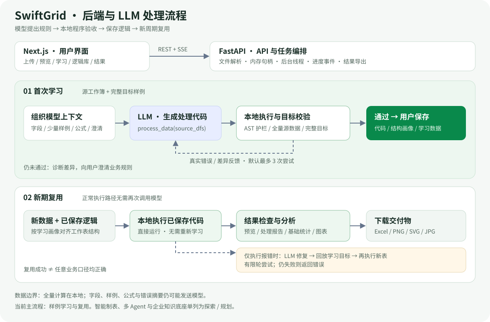
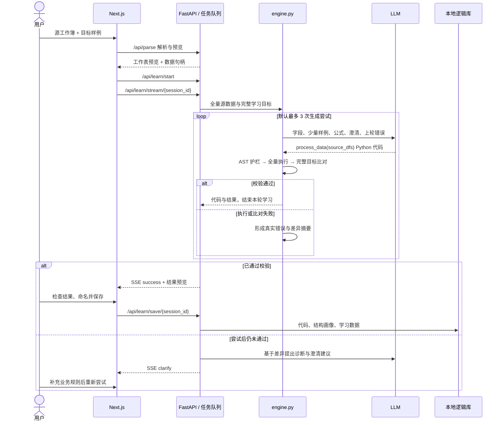
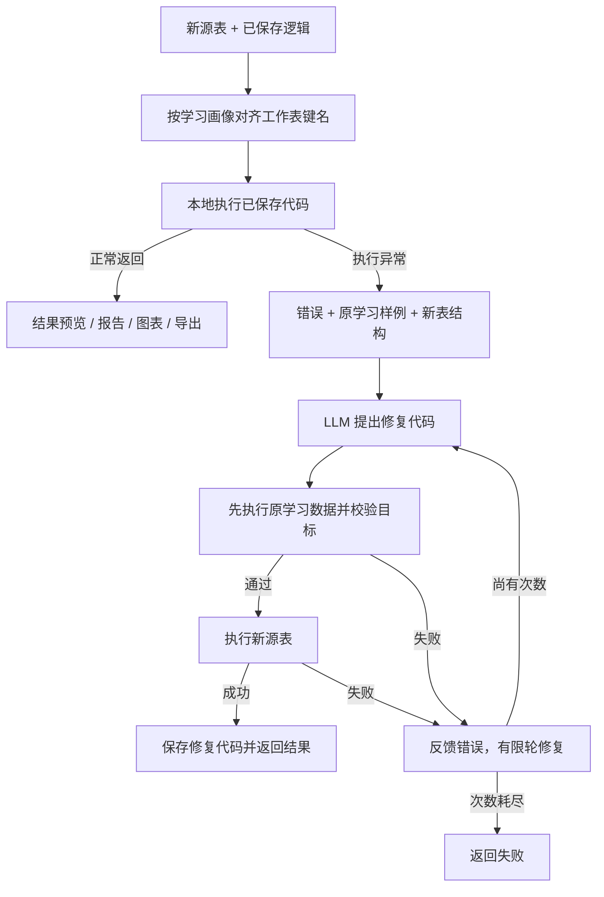

# 表速通后端与 LLM 处理流程

[返回首页](../README.md) · [公开案例](DEMO_CASE_zh.md) · [迭代计划](PRODUCT_PLAN_zh.md)

本文聚焦当前可演示的“逻辑建模”和“处理新表”。智能制表与多 Agent 建模单列为探索部分。架构描述对应仓库实现，更新于 2026-11-12。

## 1. 系统分工

| 层 | 实现位置 | 职责 |
| --- | --- | --- |
| 交互层 | [`frontend/`](../frontend/) | 输入预览、学习、逻辑库、新表处理、结果分析、图表与下载 |
| API 层 | [`swiftgrid/backend/api/`](../swiftgrid/backend/api/) | 文件解析、会话句柄、任务控制与 SSE 进度 |
| 任务层 | [`services/orchestrator.py`](../swiftgrid/backend/services/orchestrator.py) | 在线程中运行耗时任务，用事件队列向页面反馈进度 |
| 学习与复用引擎 | [`engine.py`](../engine.py) | 模型请求、生成代码护栏、执行、完整目标校验、差异与修复 |
| 逻辑存储 | [`storage.py`](../storage.py) | 保存代码、结构画像及学习数据，支持查找和复用 |
| 结果服务 | [`services/tableio.py`](../swiftgrid/backend/services/tableio.py)、[`analysis.py`](../swiftgrid/backend/services/analysis.py) | 预览与 Excel 导出、基础统计与图表数据 |
| 模型服务 | OpenAI-compatible API | 根据上下文提出处理代码、解释失败、尝试修复 |

Next.js 构建为静态文件，由 FastAPI 托管时前后端同源。开发模式可分别运行在 3000 与 8000 端口。`app.py` 是早期 Streamlit 原型。

## 2. 首次学习：输入如何变成可保存逻辑

关键入口是 `generate_and_test_logic()`：模型返回代码后，`run_process_data()` 执行，`assert_results_match()` 判断数据是否符合学习目标。通过时立即返回，不会固定消耗全部轮次。模型解释本身不能将失败状态改为成功。

“完整目标校验”指处理结果与给定目标数据的比对，**不是 Excel 文件的逐字节比较，也不意味着样式、宏、Sheet 名或复杂模板都已复刻**。目标样例覆盖不了的业务规则，仍可能被错误推断。

## 3. 新期复用：何时调用模型

实现入口为 `phase2_process_with_healing()`。正常执行分支在创建模型客户端前返回，因此**该执行分支没有模型调用**；当前 API 仍要求配置模型密钥，以支持失败后的修复路径。

修复路径默认最多 3 次，先回放学习数据、通过目标校验，再尝试新数据。它是错误恢复机制，不能保证任意字段漂移都能修复。尤其要区分：

- **报错能被发现：** 缺列、类型或代码执行异常可进入修复。
- **不报错也可能算错：** 分类含义变化、关联重复或新业务口径，可能返回看似合理的结果。新期通常没有完整目标可比对，需要跨期测试与业务约束。

本次演示只验证公开案例的成功复用，没有将所有异常、自愈分支或多目标工作簿列为已验证能力。

## 4. 模型看到了什么，数据保存在何处

| 数据 / 产物 | 当前用途与边界 |
| --- | --- |
| 完整源数据与完整学习目标 | 在服务进程内解析和执行；保存逻辑时会持久化学习数据供回放，需保护本地 `data/` |
| 字段、源表和目标表的少量样例 | 进入学习请求，可能包含真实业务单元格 |
| 公式线索、业务澄清、错误和差异摘要 | 可能发送给配置的模型服务；同样需要考虑敏感内容 |
| 新数据 | 正常复用在本地执行；发生异常时，新表结构与错误进入修复上下文 |
| 生成脚本、结构画像、学习数据 | 保存在本地逻辑库；后续直接执行或回放 |
| 模型密钥 | 服务端环境变量或进程配置；不应提交到仓库 |

因此，本项目的准确表述是“**全量计算在本地，模型使用有限上下文**”。企业使用应根据数据性质处理样例与日志，或配置符合自身要求的兼容模型网关；当前实现不提供“零数据外发”保证。

## 5. 结果分析与图表

结果页的分析以确定性统计和规则提示为主。图表接口提供聚合后的点，前端负责显示与图片导出，尚不是结合企业知识完成的专业经营诊断。

本次版本修复了前端柱形额外截断、饼图遗漏类别和图片误选图标的问题。后端仍有展示点数限制，页面会提示限量；饼图合并的是接口返回的类别。公开案例的 35 类未触及后端限制，核对了全部 35 类的总量与显示。[具体检查](DEMO_CASE_zh.md)

## 6. 探索中的智能制表与多 Agent

`services/compose_ai.py`、`compose_plan.py`、`compose.py` 探索“紧凑数据画像 → LLM 提出受控 JSON 计划 → 协议校验 → 本地 pandas / SQLite 计算”的路线。代码中已有流程不等于端到端已稳定，当前不作为主展示能力。

`scripts/modeling_multi_agent/` 另行探索意图 IR、编译、业务不变量和结果审计，尚未替代正式主 API。自然语言取数、LLM Wiki 与业务本体也尚未集成。后续路线见 [产品计划](PRODUCT_PLAN_zh.md)。

## 7. 部署与实现局限

- 当前为单实例、单租户；会话、模型配置和逻辑存储没有用户级隔离。
- AST 与受限执行环境是护栏，不是强隔离沙箱；运行生成代码仍需要独立执行边界。
- 复杂多区块模板、宏、透视表、完整样式与工作表名称契约尚不完整。
- 目标样例通过只证明符合这份数据，无法替代独立测试集、业务口径确认和跨期审计。
- 同源构建与 Docker 已提供；常驻公网服务还需要认证、隔离、限流、成本控制和持久化运维。[部署说明](DEPLOYMENT_zh.md)
