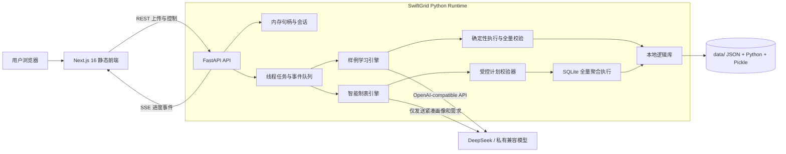
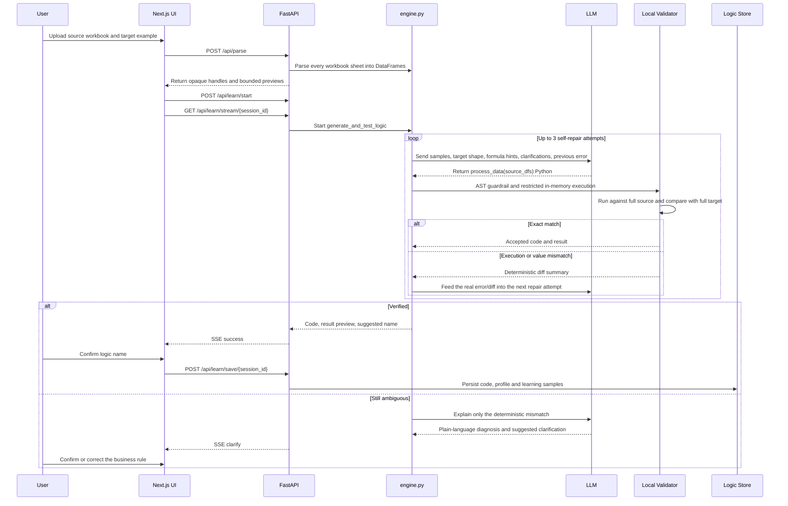
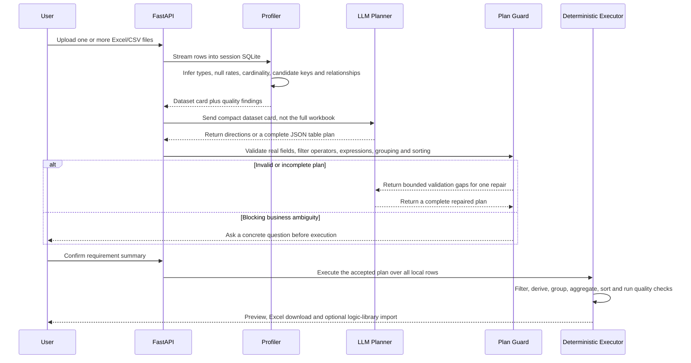
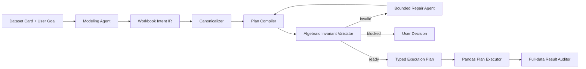

# SwiftGrid 后端与 LLM 处理架构

本文描述当前可运行版本的真实代码边界。主程序由 `frontend/`、`swiftgrid/backend/`、`engine.py` 与 `storage.py` 组成；`scripts/modeling_multi_agent/` 是下一代建模架构的实验实现，尚未替代主 API。

## 1. 系统边界

### 组件职责

| 组件 | 真实职责 |
| --- | --- |
| `frontend/` | 上传、预览、澄清、SSE 进度、结果查看和下载 |
| `swiftgrid/backend/api/` | REST/SSE 边界，校验句柄并启动后台任务 |
| `swiftgrid/backend/services/orchestrator.py` | 将阻塞模型调用放入工作线程，通过队列推送 SSE |
| `engine.py` | 样例驱动代码生成、执行、目标比对、自修正与运行期自愈 |
| `swiftgrid/backend/services/compose_ai.py` | 把紧凑数据画像和用户需求转换成受控 JSON 计划 |
| `compose_plan.py` | 校验字段、筛选、表达式、聚合和排序协议 |
| `compose.py` | 流式导入、SQLite 暂存、全量确定性执行、结果导出 |
| `storage.py` | 保存逻辑、训练样例画像、计划和结构匹配索引 |

## 2. LLM 路径 A：从源表与目标样例学习逻辑

这条路径解决“我已经做过一次，希望以后自动重复”的任务。模型负责提出 Python 转换程序，但是否成功由本地完整目标表决定。

### 模型看到什么

- 每张源表的列名和少量样例行；
- 目标结果的结构和少量样例；
- 目标 Excel 中可提取的公式线索；
- 用户已经确认的澄清；
- 上一轮真实执行错误或本地差异摘要。

### 模型不决定什么

- 不直接宣告结果正确；
- 不把抽样输出当成最终结果；
- 不绕过完整目标表校验；
- 不直接把解释文字保存成可复用逻辑。

通过校验的逻辑在处理新周期表格时先做结构匹配，再执行锁定代码。若字段结构漂移导致失败，模型可以提出修复代码；修复必须先回放学习样例并再次通过目标校验，之后才用于新表。

## 3. LLM 路径 B：只有源表时的智能制表

这条路径解决“我只有数据，希望先得到可执行制表方向”的任务。与样例学习不同，模型不输出最终数值，也不执行任意 Python；它只生成受控计划。

受控表达式仅支持字段、常量、算术、空值回退、拼接与条件表达式；聚合仅支持明确白名单。模型返回 Python、SQL 或协议外操作时，计划会被拒绝。

## 4. 数据与隐私边界

| 数据 | 默认位置 | 是否发送给模型 |
| --- | --- | --- |
| 上传的完整工作簿 | 进程内存或 `data/compose_sessions` | 否 |
| 源表样例 | 请求上下文 | 样例学习路径会发送 |
| 目标表样例/公式线索 | 请求上下文 | 样例学习路径会发送 |
| 智能制表数据画像 | 请求上下文 | 会发送紧凑画像 |
| 最终全量计算 | 本地 pandas / SQLite | 否 |
| API Key | 环境变量或进程内存 | 仅用于模型请求，不写入逻辑库 |

当前版本不是多租户服务：内存句柄、模型配置和逻辑库均为单实例共享。在没有认证、隔离、配额和独立代码沙箱前，不应直接作为匿名公网 SaaS。

## 5. 实验性多 Agent 建模架构

`scripts/modeling_multi_agent/` 提供 Workbook Intent IR、证据引用、代数不变量校验、计划编译、确定性执行和结果审计。它用于验证下一代架构，不是当前 `/api/compose/*` 的生产实现。

这一实验方向的核心不是“增加更多模型”，而是让模型输出可编译的意图，让字段粒度、关联基数、指标可加性、去重口径和证据引用在执行前被程序验证。

## 6. 运行与部署边界

- 前端通过 `next build` 导出静态文件，由 FastAPI 同源托管；
- 后端需要长进程、文件上传、SSE 和本地磁盘，因此不适合纯静态托管；
- Docker 镜像把前端构建与 Python 运行时合并成单服务；
- 若希望保留逻辑库和会话草稿，云平台应把持久卷挂载到 `/app/data`；
- 公共部署应设置 `SWIFTGRID_ALLOW_RUNTIME_CONFIG=false`，并在服务端注入模型密钥；
- 当前 AST 校验和受限 builtins 是防误用护栏，不等同于不可信代码的强隔离。公网多用户版本应把生成代码放入独立容器/微虚机，并增加 CPU、内存、网络和文件系统限制。

## 7. 当前优势与局限

### 优势

- 模型生成与本地全量验证分离，成功条件不是“模型觉得正确”；
- 失败反馈来自确定性差异，模型自修正有事实锚点；
- 智能制表使用受控计划协议，最终数值由程序计算；
- 支持多 Sheet、逻辑保存、结构匹配、SSE 进度和 Excel 导出；
- OpenAI-compatible 客户端允许切换 DeepSeek 或企业兼容网关。

### 局限

- 当前是单实例、单租户本地工具，没有账号、租户隔离与公共限流；
- 复杂 Excel 模板、跨区块报表、宏和数据透视表并非全部稳定支持；
- 样例学习仍会执行模型生成的 Python，公开部署需要更强沙箱；
- 模型只看到有限样例时，无法唯一反推的业务口径仍需要用户确认；
- 多 Agent IR 是实验代码，尚未完全接入主产品链路。
