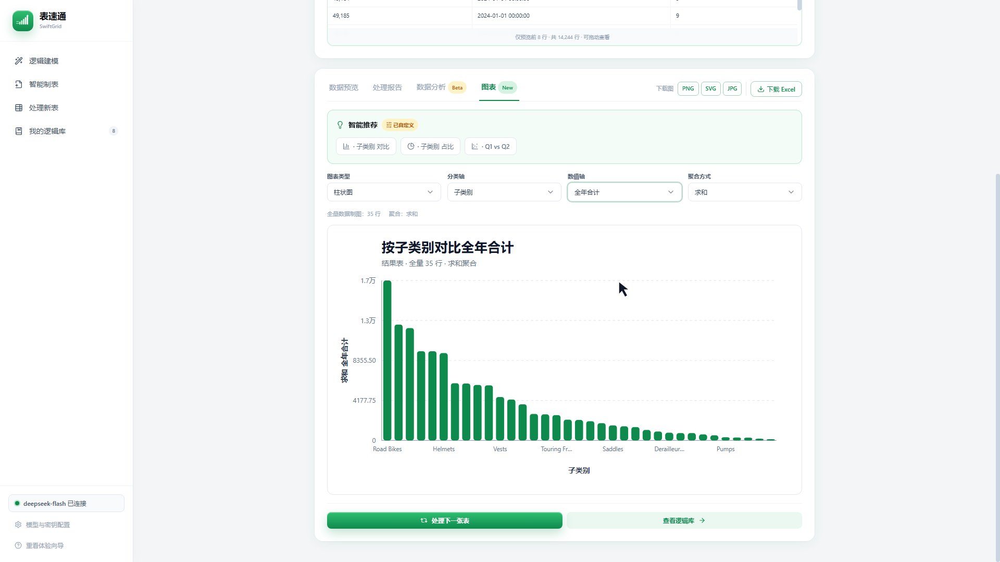
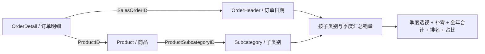
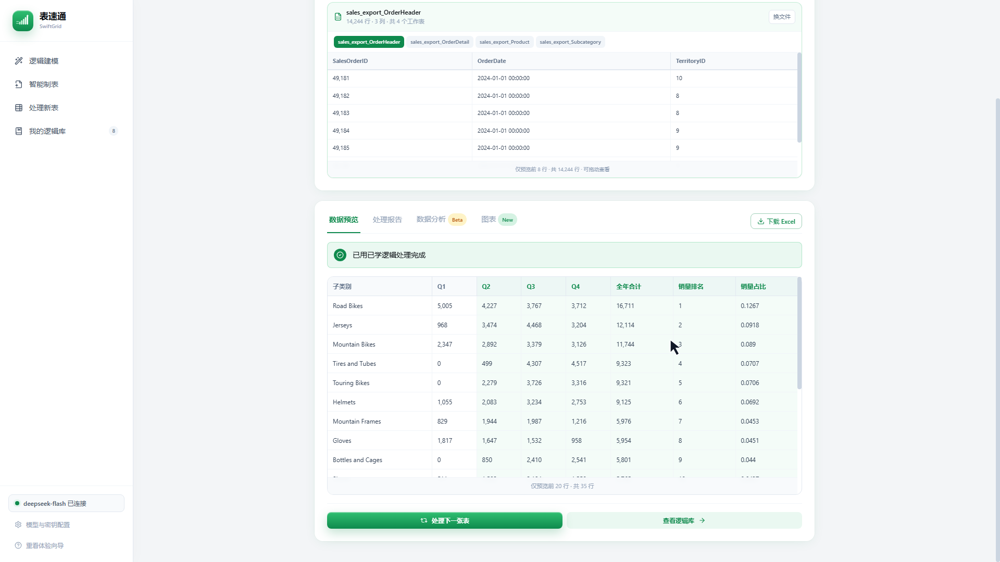

# 公开演示：四表关联、季度报表与跨期复用

[返回首页](../README.md) · [下载案例与离线核对](../examples/quarterly-sales/README.md)

## 视频与观看顺序

约 3 分 50 秒，1920×1080，中文合成解说与字幕。视频录制于 2026-11-12，使用真实网页和实际模型调用；没有回填标准答案或模拟成功响应。学习等待经过剪辑并在画面中注明，部分结果延长停留以配合讲解，视频长度不是性能测试结果。

<!-- DEMO_VIDEO -->

https://github.com/user-attachments/assets/21b556b6-2f33-4b9f-8b28-df14444e9a6f

展开查看图表页面截图

| 时间（约） | 展示内容 |
| --- | --- |
| 00:00 | 项目介绍、四张源工作表与输入预览 |
| 00:29 | 目标样例与逻辑学习 |
| 00:55 | 结果检查、处理脚本下载、命名与保存 |
| 01:22 | 逻辑库、下一年数据复用 |
| 01:49 | 处理报告与基础数据分析 |
| 02:11 | 图表推荐、自定义坐标轴与聚合 |
| 02:17 | 柱状图、饼图、散点图与直方图 |
| 03:03 | 图片和 Excel 导出 |
| 03:21 | 仅上半年数据再次复用 |

演示聚焦逻辑建模与处理新表；不包含智能制表，也没有覆盖每一种图表、粘贴输入或异常澄清分支。

## 为什么选这个案例

数据来自 [Microsoft AdventureWorks 官方样例](https://github.com/microsoft/sql-server-samples/tree/master/samples/databases/adventure-works)，经过确定性切片与列投影，使用整理后的 2023 / 2024 / 2025 展示周期，不是银行客户数据。四表保持独立，需要实际关联后才能完成目标。

下一年类别从 18 个增至 35 个；第三期只有上半年，需要保留 Q3、Q4 列并填 0。这比单张表的简单求和更能展示关联、聚合、透视和复用能力。

## 运行结果与可复查证据

| 周期 | 订单头 | 订单明细 | 商品 | 子类别 | 输出行数 | 销量合计 |
| --- | ---: | ---: | ---: | ---: | ---: | ---: |
| 学习期 | 3,830 | 20,817 | 504 | 37 | 18 | 66,441 |
| 下一年 | 14,244 | 56,721 | 504 | 37 | 35 | 131,936 |
| 上半年 | 11,699 | 37,191 | 504 | 37 | 30 | 61,511 |

三个实际下载文件的数据值、列序与行序均与独立参考计算及标准文件一致，浮点绝对容差 `1e-6`。当前实际 Sheet 名为“结果”，标准文件为“Sheet1”：**数据检查通过，工作表名称契约未通过**。没有据此宣称样式、公式或整个工作簿完全一致。

本次本机 Flash 模型学习约 57.191 秒；两次复用从上传开始到成功事件分别约 3.824 秒、2.389 秒。模型、网络、机器和任务会影响耗时；这是一次录制测量，不是平均值、SLA 或通用性能基准。一个案例的三个周期也不能推算整体准确率。

| 图表检查 | 结果 |
| --- | --- |
| 柱状图类别 | 35 个柱形完整显示 |
| 饼图合计 | 保留总销量 131,936；前 7 类外的 28 类合并为“其他类别”，合计 57,622，显示占比约 44% |
| 散点图 | Q1 与 Q2 两轴，35 个数据点 |
| 直方图 | 5 个区间，计数合计 35 |
| 标题与下载 | 修改自定义坐标轴后标题更新；PNG、SVG、JPG 实际导出均核对 |

案例源文件、学习目标、离线参考计算、实际下载结果、已保存处理脚本与核对方法见 [examples/quarterly-sales](../examples/quarterly-sales/README.md)。离线核对只验证已提供的产物，不重新调用模型，也不等于从零生成成功率测试。
